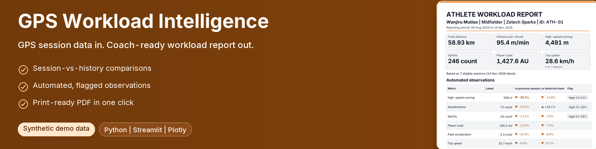

<p align="center">
  
</p>

<p align="center">
  <b>Turn GPS session data into clear, coach-ready athlete workload reports.</b><br>
  An independent portfolio prototype built with synthetic data.
</p>

<p align="center">
  <a href="https://gps-athlete-dashboard.streamlit.app/"></a>
  
  
  
</p>

## Overview

Sports teams collect large amounts of GPS data, but raw numbers are hard to act on. This project compares each athlete's latest session with their own history and presents the result as an interactive dashboard and a printable PDF report.

**[Open the live dashboard](https://gps-athlete-dashboard.streamlit.app/)**

## Features

- **Workload metrics:** total distance, distance per minute, high-speed running, sprints, accelerations, decelerations, Player Load and top speed.
- **Session vs history:** the latest session is compared with the previous session and the athlete's historical mean.
- **Automated observations:** changes are shown in one compact table, with variation flags for metrics that fluctuate a lot.
- **Trend charts:** one chart per metric, with a historical-mean reference line.
- **Data-quality screening:** sessions with missing or invalid values are flagged and excluded from the analysis.
- **PDF reports:** a print-ready report for each athlete, one click away.

## Quick start

Requires Python 3.10 or newer.

```bash
git clone https://github.com/<your-username>/gps-athlete-workload-dashboard.git
cd gps-athlete-workload-dashboard
pip install -r requirements.txt
streamlit run app/app.py
```

The dashboard opens at `http://localhost:8501`.

## Project structure

```text
app/    Streamlit dashboard
src/    Data generation, cleaning, metrics and configuration
data/   Synthetic sample data
docs/   Banner and documentation assets
```

## About the data

All athletes, sessions and GPS measurements are fictional. This is an independent portfolio prototype, not an official product of any organisation and not an assessment of real athletes. The reports describe the sample data only and must not be used for athlete selection, medical or training decisions.

## License

Released under the MIT License.